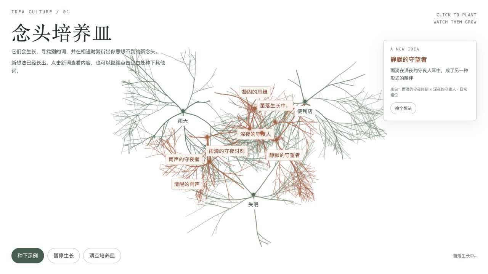
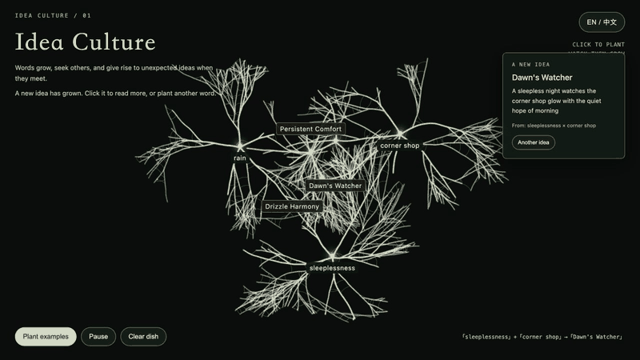

# Idea Culture / 念头培养皿

An interactive artwork for people exploring unfamiliar connections between ideas. Plant words on a digital petri dish and watch slime-mould-inspired networks grow. When networks meet, a language model proposes a new idea at the intersection; that colony can grow in turn.

## Two ways to experience the work

- **Online version:** [Open Idea Culture](https://idea-culture-living-thoughts.dustycorgi1.chatgpt.site/experience/). The hosted version has recently experienced access and idea-generation failures and may not be reachable. It uses Google Gemini; entered words are sent to that service, so please do not enter private information.
- **Local version:** Run the included application with Ollama on your own computer; follow [Run locally](#run-locally) below. This requires installing Ollama and downloading the model.

If either version is unavailable, the screenshot and recording below show the interaction without setup.



## See the interaction

This 24-second, silent recording shows the built-in example being planted, its networks growing, and generated ideas appearing. It is a capture of a real local run, sampled every three seconds. The recording is a demonstration, not an interactive version.



## Interaction

Use **EN / 中文** in the upper right to switch the interface between English and Chinese. Click a blank area, enter a word or short phrase and select **Plant / 种下**. Repeat nearby. Wait for the networks to meet, then click a new idea to read its explanation or choose **Another idea / 换个想法** to try another. Pause or clear the dish using the bottom controls; **Plant examples / 种下示例** plants examples. Newly generated ideas use the selected language; existing words and ideas stay in the language in which they were entered or generated. If the model is unavailable, the interface offers a retry.

## Run locally

Requirements: Git, Python 3, [uv](https://docs.astral.sh/uv/getting-started/installation/), [Ollama](https://ollama.com/), and enough storage and memory for `qwen3:8b` (about 5.2 GB to download). Python code uses only the standard library; there are no pip packages to install. Install and start Ollama, then run these commands in a terminal:

```sh
git clone https://github.com/9052g/assignment03-idea-culture.git
cd assignment03-idea-culture
ollama pull qwen3:8b
uv run --no-project python server.py
```

Open <http://127.0.0.1:8768/>. Stop the server with Ctrl+C. Input is sent to Ollama on your own computer, not to a cloud API. Download size and generation speed depend on the machine; a GPU is helpful but not required. If the page reports that the local model is unavailable, start Ollama, check that `ollama list` includes `qwen3:8b`, and select **重试联想** (retry). If port 8768 is already in use, stop the other application using it before starting this server.

The key online files can be read in [online/](online/), and the complete hosted application source is included in [online-source.zip](online-source.zip). Its `public/experience/` folder contains the online interface and `app/api/idea/route.ts` contains the server-side Google Gemini integration. The secret is not included. The root files and commands above remain the self-contained local Ollama version.

## Limitations

The local version requires Ollama, and GitHub Pages cannot run its Python server or local model. The online version requires a reachable hosted service and Google Gemini. Either model may take time, fail, or produce weak associations. If the service is unavailable, users can plant and watch networks grow, but new associations require a working model. The screenshot and recording above show a run without needing the model. In another test, “雨天” (rainy day) and “拓扑” (topology) produced “液态几何” (liquid geometry), with the idea that raindrops redefine the shape of space. Outputs vary between runs.

## Credits

Visual inspiration: observations of slime mould and fungal networks, including reference images supplied during design. The idea strategy was informed by [Idea Generator](https://github.com/ludi-uni/idea-generator-skill) (MIT); no code was copied. The visualisation, prompts and interface were developed with help from OpenAI Codex. See [PROCESS.md](PROCESS.md).
